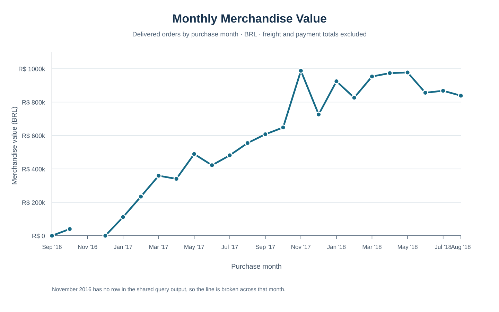
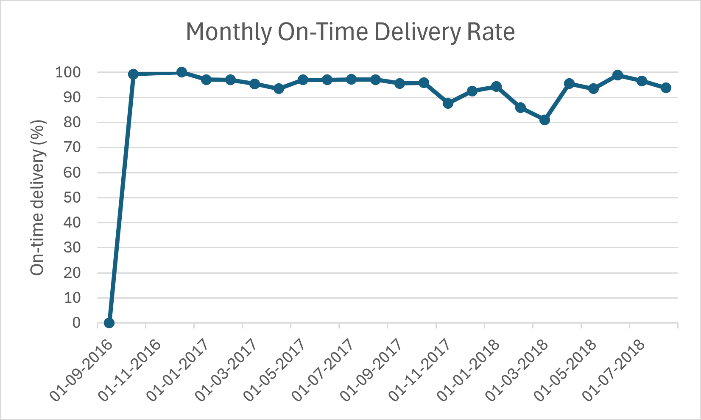

# Olist Brazilian E-Commerce Analysis with SQL Server

A SQL Server portfolio project exploring the public [Brazilian E-Commerce dataset by Olist](https://www.kaggle.com/datasets/olistbr/brazilian-ecommerce).

## Project contents

- [Schema inventory query](sql/02_schema/01_schema_inventory.sql)
- [Logical data relationship diagram](docs/relationship_diagram.md)
- [Product category mapping quality check](sql/03_data_quality/01_product_category_mapping_gaps.sql)
- [Monthly delivered-order analysis](sql/04_business_analysis/04_monthly_revenue_by_purchase_month.sql)
- [Monthly KPIs from the reporting view](sql/04_business_analysis/09_monthly_kpis_from_reporting_view.sql)
- [Monthly average merchandise per order](sql/04_business_analysis/10_monthly_average_merchandise_per_order.sql)
- [Month-over-month merchandise growth](sql/04_business_analysis/11_month_over_month_merchandise_growth.sql)
- [Repeat-purchase analysis](sql/04_business_analysis/05_repeat_purchase_analysis.sql)
- [Product-category performance analysis](sql/04_business_analysis/06_product_category_performance.sql)
- [Monthly delivery-performance analysis](sql/04_business_analysis/07_delivery_performance_by_purchase_month.sql)
- [Delivery timing and review-score analysis](sql/04_business_analysis/08_delivery_timing_vs_review_scores.sql)
- [Clean orders view](sql/05_views/01_clean_orders_view.sql)
- [Clean order items view](sql/05_views/02_clean_order_items_view.sql)
- [Clean order payments view](sql/05_views/03_clean_order_payments_view.sql)
- [Clean order reviews view](sql/05_views/04_clean_order_reviews_view.sql)
- [Clean products view](sql/05_views/05_clean_products_view.sql)
- [Order-level item and payment summaries](sql/05_views/06_order_level_totals.sql)
- [Combined order reporting view](sql/05_views/07_order_reporting_view.sql)
- [Human-readable data dictionary](docs/data_dictionary.md)
- [Imported column metadata](docs/data_dictionary_columns.csv)

## Analyses

The original monthly analysis groups delivered orders by purchase month. It aggregates item values and payment records separately by order before joining them, preventing one-to-many joins from multiplying totals. Merchandise value, freight, and recorded payment value are reported separately.

The monthly KPI query uses the combined order reporting view and reproduces the same month-by-month figures as the original monthly analysis. This confirms that the reusable view gives the same counts and totals while keeping item and payment summaries at one row per order.

The monthly average merchandise query calculates item-price value per delivered order, excluding freight. It reports averages using both all delivered orders and delivered orders with item rows. The averages match in each month because every delivered order had item rows. The monthly average ranged from BRL 124.38 in July 2017 to BRL 152.17 in October 2016.

The month-over-month query compares merchandise value with the immediately preceding calendar month. November 2016 has no delivered-order row, so December's growth measures are NULL rather than comparing December with October. The very high growth percentages in October 2016 (29,777.09%) and January 2017 (1,025,573.03%) reflect comparison months with only one delivered order each; those rates should be read alongside order volume.

The reusable order-level summaries aggregate item and payment details separately. They reconcile to 112,650 item rows across 98,666 orders with items, and 103,886 payment rows across 99,440 orders with payment records. There are 99,441 orders in total, so one order has no matching payment record. The combined order reporting view retains one row per order and keeps missing item or payment values as `NULL`.

The repeat-purchase analysis counts customers using `customer_unique_id` and includes delivered orders only. The query results show 90,557 one-time buyers (97%) and 2,801 repeat buyers (3%). Repeat buyers account for 5,921 delivered orders, or an average of 2.11 delivered orders per repeat buyer. Percentages are rounded.

The product-category analysis reports delivered item counts, distinct delivered orders per category, merchandise value, freight, and each category's share of total merchandise value. The top five categories account for 39.83% of merchandise value; health and beauty is the largest at BRL 1,233,131.72 (9.33%). An order containing items from multiple categories is counted once in each relevant category's order count. The query uses the English category translation when available and falls back to the source category name.

The category quality check identified all 1,537 items in the `[Uncategorized or missing product]` group as products with a blank category. These items represent BRL 170,726.63 (1.29%) of merchandise value and BRL 26,969.06 in freight across 1,392 delivered orders. It found no blank item product IDs or product IDs missing from the products table.

The delivery-performance analysis covers 96,478 delivered orders. Eight orders lacked an actual or estimated date, leaving 96,470 assessable orders. Of those, 89,936 (93.23%) arrived on or before the estimated calendar date. March 2018 had the lowest monthly on-time rate at 81.04% (1,328 late orders). Average days from the estimate are negative when delivery was early and positive when it was late.

For assessable delivered orders with numeric reviews, the delivery and review analysis found an average per-order score of 4.29 for on-time or early deliveries and 2.27 for late deliveries. Orders whose average score was 2 or lower made up 9.23% of reviewed on-time or early orders and 62.36% of reviewed late orders. This is a descriptive association and does not show that delivery timing caused the review scores.

One delivered order in September 2016 has no matching payment record. The monthly analysis reports the payment total as `NULL` and counts the missing payment record instead of treating it as a zero payment.

## Visual results

This chart uses item prices for delivered orders by purchase month. Freight and recorded payment totals are excluded. November 2016 has no row in the shared query output, so the line is broken across that month.

The delivery chart shows the share of delivered orders arriving on or before the estimated delivery date. September 2016 contains one delivered order, so its 0% rate is based on a very small count. See the [results folder](results/README.md) for details.

## Data and setup

The tables are in the SQL Server database `Ecommerce`, under the `dbo` schema. Imported columns are stored as `varchar`; analysis queries convert date and amount text as needed. The clean orders, order items, and reviews views convert source text fields to usable date/time and numeric types. The clean payments view converts payment sequence, installment, and value fields. The clean products view converts product counts and measurements to integers; blank source attributes remain `NULL`.

To run an analysis or create the views, open the relevant SQL file in SQL Server Management Studio and execute it against a database loaded with the Olist tables. The dataset itself is not included in this repository.

## Data source

[Olist Brazilian E-Commerce Public Dataset on Kaggle](https://www.kaggle.com/datasets/olistbr/brazilian-ecommerce)
