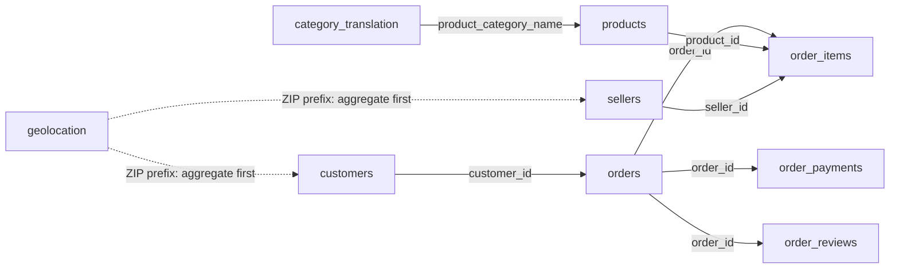

# Logical Data Relationship Diagram

This diagram shows the common join paths used in the project. The arrows identify join columns; they do not assert enforced foreign-key constraints or guaranteed relationship counts.

## Join paths

| From | To | Join columns |
|---|---|---|
| `customers` | `orders` | `customer_id` |
| `orders` | `order_items` | `order_id` |
| `orders` | `order_payments` | `order_id` |
| `orders` | `order_reviews` | `order_id` |
| `products` | `order_items` | `product_id` |
| `sellers` | `order_items` | `seller_id` |
| `category_translation` | `products` | `product_category_name` |
| `geolocation` | `customers`, `sellers` | ZIP prefix columns |

## Notes

- The imported SQL Server tables did not have declared foreign-key constraints in the schema inventory. These are logical join paths based on the dataset columns.
- `geolocation` can contain multiple rows for the same ZIP prefix. Aggregate it to one row per prefix before joining it to customers or sellers; otherwise, the join can multiply rows.
- Use `customer_unique_id` in `customers` to identify repeat buyers. `customer_id` identifies the customer record associated with an order in this dataset.
- The imported columns are stored as `varchar`; convert dates and numeric values when analyzing them.
